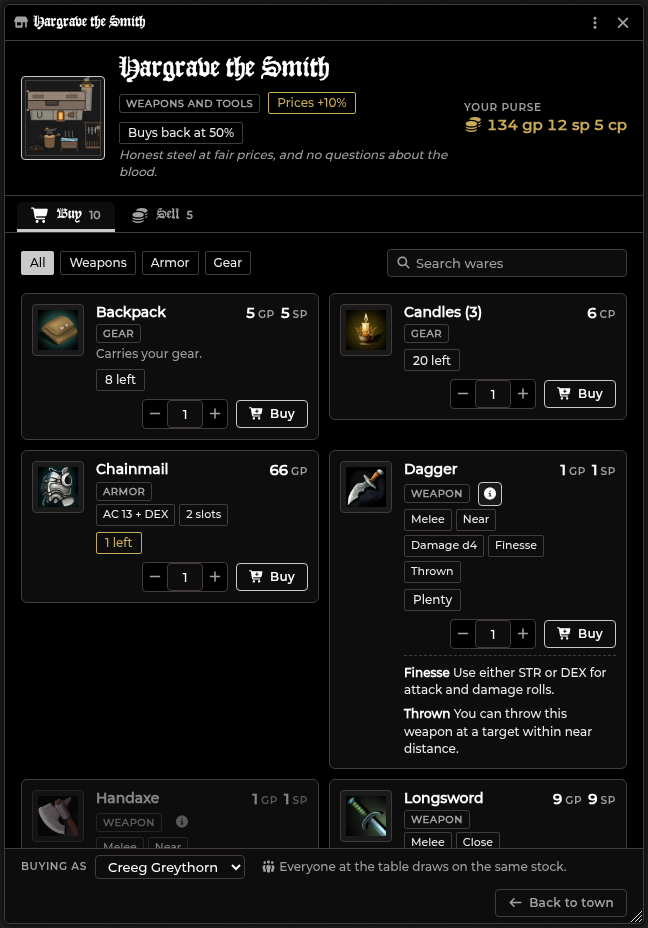
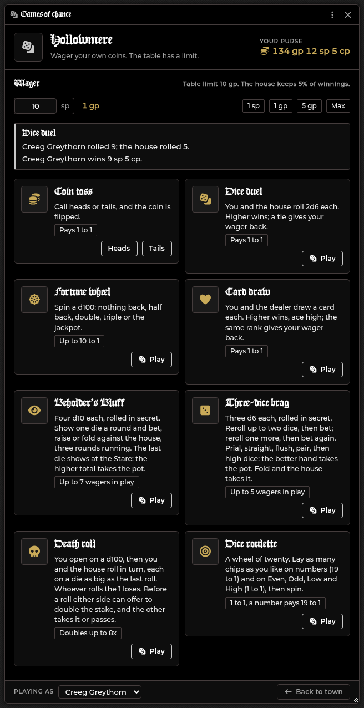
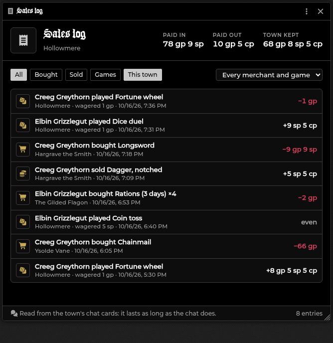

# Town Landing Page

[← Wiki home](index.md)

A front door for a town. The scene's own picture fills the screen and a menu
runs down the right: the town's name, a line for each merchant, and the Quest
Log, the Journals, the Party and Downtime. Players shop with their own
characters, and they can do it between sessions with you not connected. A table of games of
chance and a sales log for the GM can be added to the same page.

*The picture here is a sample. On your table it is the scene's own picture.*

Any scene can have one. Everything on it is read from your NPCs and the scene as
they are, so changing an NPC's items or a price changes the shop.

---

## Putting it up

Press the **Landing page** button (a landmark icon, in the Token Controls on the
left of the screen) or **Alt+T**. The first time on a scene it makes an empty
page: the scene's name, the four entries and no merchants. Then:

- **It is up for everyone on the scene, you included.** The button is lit while
  it is up.
- **Press it again** and it goes away for everyone. The page is kept, merchants
  and all; press again to bring it back. The eye icon on the page does the same.
- **Moving between scenes** follows the page. Arriving in a scene whose page is
  up opens it; arriving in one without a page, or with its page taken away,
  closes it.

The picture is the scene's own. Choose it, and where the camera starts, in the
scene's settings (the editor has a **Scene settings** button for it). The menu
fades dark on the right, so keep that side of the picture quiet. Players can
still pan and zoom the scene as usual.

When Foundry's sidebar is open the menu moves left of it, and if the Crawl Strip
is up and would cover the town's name, the menu sits just below it.

---

## Setting up a town

1. **Make each merchant an NPC actor.** Give it items of the types **Basic**,
   **Weapon** or **Armor**. Those items are the stock: an item's quantity is how
   many the merchant has, and its price is what it charges. Other item types
   are not sold.
2. **Press the pencil** on the page (the GM sees four icons at the top: the
   pencil for the settings, the receipt for the [sales log](#the-sales-log), a
   button that restocks every shop, and the eye that takes the page away).
3. **Fill in the town**, then pick an NPC under **Merchants** and press **Add
   merchant**. Set each merchant's fields (below).
4. **Save.** Every open page updates at once.

| Field | What it does |
|---|---|
| **Name, Tagline, Welcome text** | The heading, the italic line and the paragraph under it. Name defaults to the scene's name |
| **Around town** | Which entries players see: Quest Log, Journals, Party, Downtime |
| **Open a games table** | Adds **Games of chance** to the menu (see Games of chance). Off until you turn it on |
| **Largest bet (gp)** | The most one game may stake, 1 to 1000 gp (10 by default) |
| **House keeps (% of winnings)** | The share of every win the town keeps, 0 to 50 (5 by default) |
| **Role, One-line pitch** | The line under the merchant's name and the hover text |
| **Prices %** | 100 charges list price; 110 is 10% dearer, 80 is 20% cheaper (10 to 500) |
| **Buys back %** | What the merchant pays for what a player sells, as a share of the item's price (0 to 100) |
| **Open** | A closed merchant shows as closed and cannot be visited |
| **Restock** | Puts the merchant's whole shelf back when you press Save (see Restocking) |
| **Edit stock** | Opens the NPC, so you edit its items there |

An NPC can be a merchant once per town. The same NPC in two towns has its own
stock in each. Removing a merchant and adding the NPC again starts it fresh.

---

## What players see

- **The merchants** are listed by name with their role. Pressing one opens its
  shop. A merchant you closed shows as closed.
- **The other entries** open the [Quest Log](Quest-Log.md), the Journal sidebar,
  the [Party](Party.md) and [Downtime](Downtime.md). An entry that cannot open is
  greyed and says why: Party until the player can see a party (the
  [Party](Party.md) needs at least Observer), Downtime until you start a
  downtime session.
- **The foot** says which character the player is, and their purse.
- **Their own copy.** While you have the page up, a player can close it for
  themselves and bring it back with the same button or Alt+T. When you take it
  away they have neither.

Change the key under *Configure Controls*.

---

## Shopping

- **Buying as** (bottom left) picks which of the player's characters pays. It
  starts as the selected token's character, else the one assigned to the
  account.
- **Filter and search.** The chips filter by Weapons, Armor and Gear; the
  search box narrows by name.
- **What a ware is.** Every card shows facts read from the item's own stats, so
  a ware with no written description still says what it is: a weapon's kind,
  range, damage and properties (Melee, Near, Damage d4, Finesse, Thrown), an
  armor's AC (AC 13 + DEX, +2 AC for a shield), and how many slots it takes. The
  start of the item's description sits under the name. The **info** button (or a
  click on the name) opens the whole description and what each property does.
- **Buy.** Set the quantity with the stepper and press **Buy**. Coins come off
  the character's purse and the item lands on its sheet. A ware that costs more
  than the purse shows its price in red and cannot be bought. Gear sold in
  bundles (arrows, rations) is priced per bundle.
- **Sell.** The **Sell** tab lists what the character carries of those types
  and what one unit pays at the merchant's buy-back %. **Sell** sells one;
  **All** sells the stack. The merchant does not restock what it buys.
- **A chat card** is posted for each sale, in the merchant's name.
- **A downtime extortion swing** a character has armed applies to the next
  buy or sale, as in the [Merchant Shop](Merchant-Shop.md).

---

## Games of chance

Turn on **Open a games table** in the settings and **Games of chance** joins the
menu. A player picks their character, sets a **wager** in silver (quick buttons
for 1 sp, 1 gp, 5 gp, 10 gp... and the table's limit) and plays one of four games.
The wager comes out of the purse only when the game is played, and a result
card is posted to the chat for everyone to see.

| Game | How it plays | Pays |
|---|---|---|
| **Coin toss** | Call heads or tails; the coin is flipped | 1 to 1 |
| **Dice duel** | You and the house roll 2d6 each; higher wins, a tie gives the wager back | 1 to 1 |
| **Fortune wheel** | A d100: 1-45 nothing back, 46-68 half back, 69-90 double, 91-98 triple, 99-100 the jackpot | Up to 10 to 1 |
| **Card draw** | You and the dealer draw a card each, ace high; higher wins, the same rank gives the wager back | 1 to 1 |

The **house keeps** a share of every *win*: at 5%, a 100 cp wager that wins pays
95 cp. A loss, a tie and the wheel's half-back are not touched by it, and the
winnings round down. With no cut the coin, the duel and the cards are exactly
fair and the wheel returns 99.5% of what is staked, so the cut is what makes the
house win over a night. The **largest bet** is the table's limit: the house has
no purse to run dry, so the limit is what bounds a lucky streak.

Like a purchase, a game only changes the player's own character, so it works
with no GM connected. Dice are rolled with Foundry's own dice and show in Dice So
Nice when it is installed.

---

## The sales log

The receipt icon on the page (GM) opens the **Sales log**: every purchase, sale
and game at the town's tables, newest first, with who did it, where, when, and
the coins the character gained or lost. Filter by **Bought**, **Sold** or
**Games**, by merchant or game, and between **This town** and every town. The
header totals what was **paid in** (purchases and lost wagers), **paid out**
(sales and winnings) and what the **town kept**.

The log is read from the chat cards the town posts (each carries its facts), so
it works with no GM connected and it lasts as long as the chat does: clearing
the chat clears it, and sales made before the log existed are not in it.

---

## Stock and restocking

A merchant's stock is its NPC's items. Each purchase is recorded on the
buyer's own character, and what is left on the shelf is the NPC's quantity
minus what everyone has bought. So the whole table draws on the same stock,
and every open shop updates as others buy.

- **Never runs out.** As the GM, press the infinity button beside a ware's
  type in the shopfront. A ware that never runs out shows **Plenty**.
- **Restock.** Press **Restock** on a merchant in the editor (it takes effect
  when you Save), or the restock button on the page for every shop. The shelf
  is back to the NPC's quantities. Nothing is written to any player's
  character.
- **Changing an NPC's quantity** changes the shelf at once: raise it to add
  stock without a restock.

---

## Without the GM

A player's purchase only changes their own character: coins out, the item in,
and a line in their own record. A player may write their own character, so
shopping works with no GM connected. This is why the stock is kept on the
buyers' characters and not in a setting only the GM can write.

Because of that, town sales are not written to the Merchant Shop's transaction
log or the [Session Recap](Session-Recap.md). The chat cards are the record, and
the sales log reads them.

---

## Limits

- A player shops as a Player character they own. The GM can shop as any.
- Two players taking the last unit at the same instant can both get it.
- Shopping as a token that is not linked to its actor is not counted against
  the stock.
- A merchant whose NPC was deleted is hidden from players and shown to you as
  an Unknown NPC, ready to remove.
- Items with no price sell for nothing.
- The page does not lock the camera: players can pan and zoom the picture.
- A game's dice are rolled on the player's own client, like everything else a
  player does to their own character; the wager limit is the safeguard, not the
  house's purse.

---

## A tavern page

Tick **Carouse** and **Rumors** in the page's settings (the pencil) and the same
page becomes a tavern. A new page does not get these two; only the four town
entries.

- **Carouse.** You open the Carousing window on the party that has a night open,
  or on the first party if none does, and start a night there. A player can open
  it only while a party they can see has a night open; it then opens that party's
  Carousing tab. Until then the entry is greyed and says it opens when you start
  a night. Carousing needs a GM connected, so with none the entry stays greyed and
  says so.
- **Rumors.** You get the usual Give rumors dialog. A player opens the Rumors
  Heard journal, which exists once any rumor has been given; until then the entry
  is greyed.

The games table, the shop and the sales log close with the page, so nothing is left
open when it goes away.

---

## Related

[Merchant Shop](Merchant-Shop.md) (the GM-run shop for the whole table),
[Quest Log](Quest-Log.md), [Party](Party.md), [Downtime](Downtime.md).
