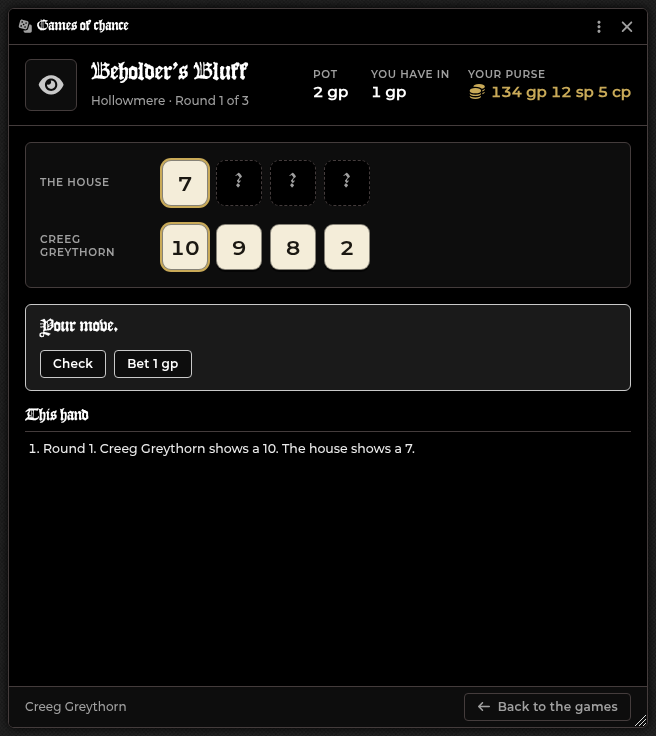
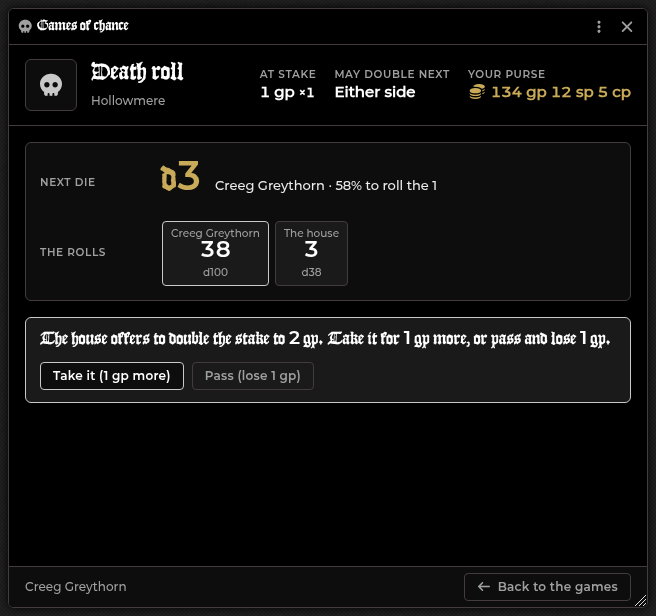
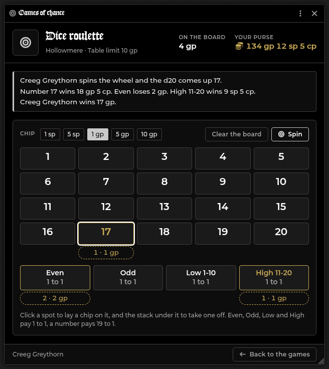
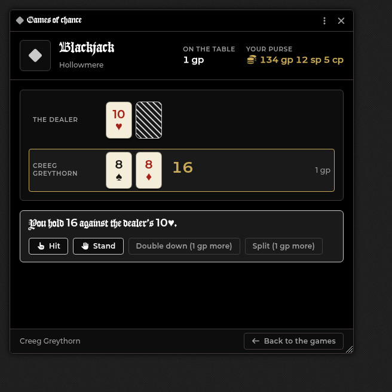
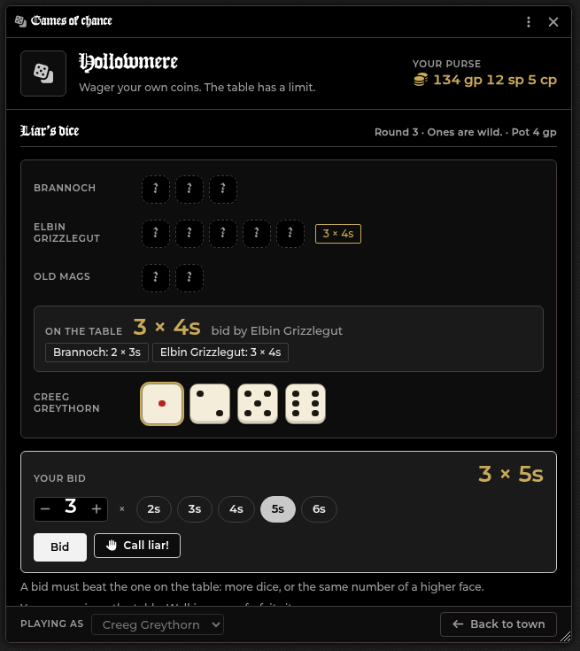

# Town Landing Page

[← Wiki home](index.md)

The landing page is a table the party sits at between adventures: a candle-lit
wooden table seen from a seat at it, with the party's portraits standing in
frames along the far edge. The things on the table are the buttons. Players
shop with their own characters, and they can do it between sessions with you
not connected.

Try it in your browser, no Foundry needed: the
[landing table demo](demo/landing-table/).

---

## Bringing the table up

Press the **Landing page** button (a landmark icon, in the Token Controls on the
left of the screen), or Alt+T. Everyone is taken to the table. Press
**Return everyone to ...** in the bar under the table, and everyone goes back to
the scene they came from. It is Foundry's own scene change, so the party's
tokens stay where they were and travel on a hex map waits for you. If you
brought the table up some other way (from Foundry's scene list, say), it goes
back to the last scene that was active, else to the party's hex map, else to the
first scene in the navigation bar.

The first press makes the table: a scene called "The Table", one merchant whose
goods are rolled for the settlement the party is in, and the page with Quests,
Journals, Session recaps, Party, Map and Carouse on (Downtime too in a Town or
bigger), every game offered. Nothing to upload or wire. Change anything
afterwards with the pencil.

**The settlement.** When the party's travel token stands on a village, town,
city or city-state hex of your hex map, the market is stocked for that size each
time you bring the table up (its goods are rolled again when the size changes).
In open country, or with no hex map, it stays as it was (a Town at first). You
can change it any time with **Settlement size** in the bar under the table.

While the table is up it is the whole screen: the scene tools, the scene list,
the hotbar and the module's crawl bar step aside, and the sidebar folds to its
tabs. They come back when the table goes away. Only you see the small bar under
the table: who you are buying as, Return, the settlement size, the pencil, the
sales log, Restock all and the eye that takes the page away for everyone (Alt+T
brings it back).

## What is on the table

| On the table | Opens |
|---|---|
| The quest tome | The [Quest Log](Quest-Log.md). Its pages list the active quests and their steps with tick boxes, over both pages |
| The coin chest | The market's shop (it opens to its gold first). The number on it is the party's coin |
| The dice cup | [Games of chance](#games-of-chance) |
| The goblets | Carouse (see [A tavern page](#a-tavern-page)) |
| The framed map | [The Map](#the-map) |
| The sealed letter | Rumors, when you tick it |
| The hourglass | [Downtime](Downtime.md) (a Town or bigger) |
| The journal | The Journal sidebar |
| The tied scrolls | The [Session Recap](Session-Recap.md) |
| A portrait frame | That character's sheet (players: their own). Hover for name, level, class, hit points and purse |
| The Party sign | The [Party](Party.md) |
| The title card | Nothing: you click it and type the session's title ("Session 14: ...") |
| The dial | Nothing: it shows the time of day from the world's clock |

At rest the table is dim; the thing under the pointer comes up in warm light with
its name. Text on the table (quest lines, the title, the names) shrinks to fit
whatever you write. Something that cannot open now is greyed and says why when
you point at it: Party until the player can see a party, Downtime until you start
a downtime session, Carouse until you start a night (or while no GM is
connected), Rumors until a rumor has been given, the Map while the world has no
overland map.

The table is the module's own picture, rendered in Blender
(`tools/landing-table/`); see [CREDITS](https://github.com/DimitroffVodka/shadowdark-enhancer/blob/master/CREDITS.md)
for the CC0 pieces in it.

---

## Setting up a town

1. **Make each merchant an NPC actor.** Give it items of the types **Basic**,
   **Weapon** or **Armor**. Those items are the stock: an item's quantity is how
   many the merchant has, and its price is what it charges. Other item types
   are not sold.
2. **Press the pencil** in the bar under the table (next to it: the receipt for
   the [sales log](#the-sales-log), a button that restocks every shop, and the
   eye that takes the page away).
3. **Fill in the town**, then pick an NPC under **Merchants** and press **Add
   merchant**. Set each merchant's fields (below).
4. **Save.** Every open page updates at once.

Instead of picking an NPC you already have, use **Generate merchant** under the
list (see [Generating a merchant](#generating-a-merchant)).

| Field | What it does |
|---|---|
| **Name** | The name the games tables and the sales log go by. Defaults to the scene's name |
| **Around town** | Which things on the table players can use: Quest Log, Journals, Party, Map, Downtime, Carouse, Rumors (Rumors is off on a new table; see A tavern page) |
| **Games of chance** | A tick box per game: the games this place offers. Tick none and the dice cup offers no games (see Games of chance) |
| **Largest bet (gp)** | The most one wager may stake, 1 to 1000 gp (10 by default) |
| **House keeps (% of winnings)** | The share of every win the town keeps, 0 to 50 (5 by default) |
| **Role, One-line pitch** | The line under the merchant's name and the hover text |
| **Prices %** | 100 charges list price; 110 is 10% dearer, 80 is 20% cheaper (10 to 500) |
| **Buys back %** | What the merchant pays for what a player sells, as a share of the item's price (0 to 100) |
| **Open** | A closed merchant shows as closed and cannot be visited |
| **Restock** | Puts the merchant's whole shelf back when you press Save (see Restocking) |
| **Restock (days)** | The shelf puts itself back this many world days after its last restock. 0 means only by hand (see Restocking) |
| **Allows haggling** | On by default. Off removes the Haggle button for this merchant (see Haggling) |
| **Edit stock** | Opens the NPC, so you edit its items there |

An NPC can be a merchant once per town. The same NPC in two towns has its own
stock in each. Removing a merchant and adding the NPC again starts it fresh.

---

## The Map

The **framed map** shows the player who pressed it, alone, the real overland map
(the hex map the party travels on) with what their party has explored; the rest
of the table stays at the table. The unexplored hexes are black as usual, and
the player sees their own party's hexes even with no token of theirs on the
map. A **Back to** button takes them back to the table. A world with no overland
map greys the map out.

---

## Shopping

- **Buying as** (bottom left) picks which of the player's characters pays. It
  starts as the selected token's character, else the one assigned to the
  account.
- **Filter and search.** The chips filter by Weapons, Armor and Gear; the
  search box narrows by name.
- **What a ware is.** Every card shows facts read from the item's own stats, so
  a ware with no written description still says what it is: a weapon's kind,
  range, damage and properties (Melee, Near, Damage d4, Finesse, Thrown), an
  armor's AC (AC 13 + DEX, +2 AC for a shield), and how many slots it takes. The
  start of the item's description sits under the name. The **info** button (or a
  click on the name) opens the whole description and what each property does.
- **Add to cart.** Set the quantity with the stepper and press **Add to cart**.
  The same ware added twice stays one line. A ware that costs more than the
  purse shows its price in red. Gear sold in bundles (arrows, rations) is
  priced per bundle, and a ware card shows what will actually be charged, even
  for a bundle that is partly sold.
- **The cart** sits above the foot of the window: each line has plus, minus and
  remove, and the total updates as you change it. A quantity is cut to what is
  on the shelf, and the cart says so. The cart is kept while you switch which
  character buys (the prices are worked out again) and is emptied when you open
  another merchant.
- **Checkout.** One press buys everything: coins come off the purse and the
  items land on the sheet, line by line. Checkout is greyed while the total is
  over the purse. If the GM changed a price, a restock came or a haggle landed
  since you filled the cart, nothing is charged and the cart says the prices
  changed, so you look it over and press again. If a line cannot be completed,
  the lines before it stay bought and the chat card names the line that failed.
- **Sell.** The **Sell** tab lists what the character carries of those types
  and what one unit pays at the merchant's buy-back %, with the same facts and
  short description as the Buy tab. **Sell** sells one; **All** sells the
  stack. The merchant does not restock what it buys. Below the list, **Sold
  here** keeps what this character sold to this merchant (see
  [Taking it back](#taking-it-back)).
- **A chat card** is posted for each checkout (one card listing every ware
  bought) and each sale, in the merchant's name.
- **A downtime extortion swing** a character has armed applies to the next
  sale, or at checkout to the dearest line of the cart only, and is used up
  only if that line is bought. See the [Merchant Shop](Merchant-Shop.md).

---

## Haggling

The **Haggle** button is in the shop header (it does not need anything in the cart), unless the GM switched haggling off
for that merchant. A character gets **one try per merchant per restock**: roll
d20 and add the character's Charisma modifier.

| Natural roll or total | Result | Every price at that merchant |
|---|---|---|
| Natural 20, or total 20 or more | Masterful deal | 25% off |
| 17 to 19 | Sharp deal | 15% off |
| 14 to 16 | Good deal | 10% off |
| 11 to 13 | Fair deal | 5% off |
| 8 to 10 | No change | unchanged |
| 5 to 7 | Shaky | 10% dearer |
| 2 to 4 | Insulted | 25% dearer |
| Natural 1, or total 1 or less | Thrown out | the character is banned |

- **How long it lasts.** A good or bad result applies to everything the
  character buys from that merchant, in the cart and on the cards, until the
  merchant restocks. A restock is a new negotiation, so the character can try
  again. It never changes what the merchant pays for what a player sells.
- **The ban is permanent.** A banned character sees the shop shut, and cannot
  buy, sell or take back from that merchant. At Charisma +0 every try has a 1 in
  20 chance of it, and tries come back with each restock, so over a long
  campaign it is likely to happen to someone.
- **Pardon.** When you shop as a banned character, the shop header shows a
  **Pardon** button. Pressing it lets the character back in; that restock's
  attempt stays used.
- **The roll** is posted to the chat only after the result is saved, so a
  roll you can see always counted.
- **Turning it off.** Untick **Allows haggling** on the merchant in the editor.

---

## Taking it back

Every sale to a merchant is kept in the **Sold here** list on the Sell tab: the
item, how many and what the character was paid. The newest ten per merchant are
kept, and a restock does not clear them. **Take back** charges exactly what the
character was paid, with no markup, no haggle and no extortion swing, and gives
the item back as it was sold, with its own flags. It cannot be done while the
merchant is closed or the character is banned. The chat card and the sales log
call it "(bought back)".

---

## Games of chance

Tick the games this place offers in the settings (a page made with
the table starts with all ten) and **Games of chance** joins the
menu, listing only those games. A player picks their character, sets a **wager** in silver (quick buttons
for 1 sp, 1 gp, 5 gp, 10 gp... and the table's limit) and plays one of ten
games. Four settle on one roll. The other six open a table of their own,
because there is something to decide. A result card is posted to the chat for
everyone to see.

**One roll.** The wager comes out of the purse only when the game is played.

| Game | How it plays | Pays |
|---|---|---|
| **Coin toss** | Call heads or tails; the coin is flipped | 1 to 1 |
| **Dice duel** | You and the house roll 2d6 each; higher wins, a tie gives the wager back | 1 to 1 |
| **Fortune wheel** | A d100: 1-45 nothing back, 46-68 half back, 69-90 double, 91-98 triple, 99-100 the jackpot | Up to 10 to 1 |
| **Card draw** | You and the dealer draw a card each, ace high; higher wins, the same rank gives the wager back | 1 to 1 |
| **Liar's dice** | A match against the house: five dice each under cups, bid and call until one side is out of dice (see below) | 1 to 1 |

**A table of its own.** There is no GM and no house purse, so these are played
against the house, whose moves are made for it from only what a player at the
table could see. Closing the window, or going back, in the middle of a game
walks away from it and loses what is in the pot.

### Beholder's Bluff

Both sides roll four d10 in secret and ante one wager. Each round you **show
one of your dice** (the house shows one too) and then bet; after three rounds
the last die shows and the higher total takes the pot. Betting is fixed-limit:
**Check**, **Bet** one wager, **Raise** one more (once a round), **Call** or
**Fold**. You open the first and third round, the house the second. Equal
totals give every wager back. The house reads the odds from your shown dice and
what is in the pot, so showing a high die first can bluff it off a hand, and
hiding one can build a pot.

### Three-dice Brag

Both sides roll three d6 in secret and ante one wager. In round 1 you may
**reroll up to two dice** (the house may too, and the log says how many it
rerolled) and then bet; in round 2 you may reroll **one**, then bet again.
The better hand wins: a prial (all alike), a straight, a flush (all odd or all
even), a pair, then the high dice. A pair of one parity is a flush. Equal hands
give every wager back.

### Death roll

You open on a d100; then the house and you take turns, each on a die as big as
the last roll. Whoever rolls the **1** loses the stake. The one about to roll is
always the underdog (never worse than 1 in 3, never better than even), and the
window shows the odds of the die coming. Before a roll either side can **offer
to double the stake**: the other **takes** it (both stakes double, and the taker
holds the right to double next) or **passes** and loses the stake as it stood.
Nobody doubles past 8 times the wager. The house takes a double it wins a third
of the time or more, so it passes at a d2 and doubles when you are about to roll
a small die.

### Dice roulette

The wheel is a d20. Pick a chip size, click spots to lay chips (a click lays one,
the stack under the spot takes one off), then **Spin**: one d20 settles every
spot at once. **Even**, **Odd**, **Low** (1-10) and **High** (11-20) pay 1 to 1,
a number pays 19 to 1. Nothing is taken until the spin, so closing the window
costs nothing, and the layout stays so you can bet it again. The whole board
may not stake more than the table's limit.

### Blackjack

You and the dealer get two cards, one of the dealer's face down; every hand is
dealt from a freshly shuffled deck of 52, so counting cards earns nothing. Cards
count their pips, faces ten, an ace eleven or one. **Hit** for another card,
**Stand**, **Double down** (one more card and no more, for a second wager, on a
hand of two cards) or **Split** a pair of the same value into two hands with a
second wager (once; split aces take one card each, and 21 on a split hand pays 1
to 1). Over 21 loses at once. The dealer draws to 17 and stands on every 17, soft
ones too, and does not draw at all when you have bust. A natural 21 on your first
two cards pays **3 to 2**; the dealer has looked at its hole card by then, so if it
has a natural too the hand is a push, and if only it has one you lose the wager
before you can put more on the table. Insurance and surrender are not offered.
The dealer has no choices to make, so there is no house skill to set: with the
rules above a player who plays the book loses a fraction of a percent to the
deck, and the town's cut comes on top of that.

### What the house keeps

The **house keeps** a share of every *win*: at 5%, a 100 cp wager that wins pays
95 cp. In a hand or a round it takes that share of what the *house* put in the
pot, never of your own coins. A loss, a tie and the wheel's half-back are not
touched by it, and the winnings round down. With no cut the coin, the duel, the
cards and roulette are exactly fair, and the wheel returns 99.5% of what is
staked, so the cut is what makes the house win over a night. The **largest
bet** is the table's limit on one wager (a hand puts in up to 7 wagers in Bluff
and 5 in Brag, a round of the death roll up to 8, a hand of blackjack up to 4
when both split hands are doubled, a roulette board up to the limit in all), and the house has no purse to run dry, so the limit is what
bounds a lucky streak.

Like a purchase, a game only changes the player's own character, so it works
with no GM connected. Dice are rolled with Foundry's own dice and show in Dice So
Nice when it is installed; the blackjack deck is shuffled from Foundry's random
source, so it shows no dice.

### Liar's dice

Liar's dice is played at a **table of two to six**: you, other players, and the
**house's players** (each with its own name and way of playing, from careful to
reckless). **Play** on Liar's dice opens a set-up screen with two steppers: how many
of the house's players, and how many **seats for other people**.

- With no seat for other people, **Sit down** starts the match at once, against the
  house only. Nothing is sent to anyone.
- With seats for other people, **Open the table** puts you in a lobby. The other
  players see the table listed above the games (with its wager and free seats, and a
  notice when it opens) and **Join** it. When you are ready, **Start now**: any seat
  nobody took is played by the house. **Call the table off** gives everyone their
  wager back.

A **How to play** button on the Liar's dice card (and a **?** in the header of every
Liar's dice screen) opens the rules in the game, with a worked example and a few tips,
so nobody needs this page to learn it. The short version follows.

Everyone starts with **five dice**, rolled under a cup the others cannot see; you see
your own dice and only the cups of the others. The seats take turns round the table:

- **Bid** how many dice of one face lie under *every* cup, for example "3 × 5s".
  Dial the count with the minus and plus buttons and pick the face from the round
  buttons; the box shows the bid you are about to place. Each bid must beat the
  last: a higher count, or the same count on a higher face. Ones are **wild**: they
  count as any face, and nobody bids on ones.
- Or **call liar** on the last bid. Every die is shown. If the bid's count or more is
  there, the bid held and **the caller** loses a die; if not, **the bidder** does.
- The loser of a round opens the next (the seat after them if that was their last
  die), and the new round's dice tumble on the table so you can see they were
  rolled (the cups shake and the round label flashes; nothing moves for a player
  whose system asks for less motion). The last seat with dice wins the **pot**.
  Someone who is out can keep watching.

**An example round.** Three at the table, five dice each. Your dice are 1, 3, 5, 6, 6.
Elbin bids "four 5s". You hold a 5 and a wild 1, so two are already yours; only two
more are needed among the ten hidden dice, which is likely, so you raise to "five 5s".
Brannoch thinks that is too many and calls liar. The cups are lifted and the 5s and 1s
come to six, so the bid was true: Brannoch, who called, loses a die and opens the next
round. Had there been only four, you would have lost the die instead.

**Money.** Each person puts the table's wager in **when they sit down**, from their
own character, and only their own client moves their own coins, so it works with no GM
connected. The pot is the wager of every seat; the house's players put theirs in out
of the town's purse. A person who wins is paid their wager back and the other seats'
wagers, less the town's cut of those winnings (against three of the house's players
that pays 3 to 1); a house player that wins takes the pot. Someone who **walks away
from a match** (closing the window, or Back to town) forfeits their wager and their
dice go; someone who leaves the **lobby** gets their wager back. If the **host** calls
the table off, or drops off the world, everyone else's wager goes back; a host who
leaves a match in play loses their own, like anyone who walks away. Keep the window
open if you are the host: it runs the table for everyone. Each person's result is
posted to the chat (the host's card lists every round) and goes in the sales log.

**Hidden dice.** The host's computer runs the table and sends each person only their
own dice, so nobody is shown another seat's dice before a call. The house's players
decide from their own dice, how many dice are hidden and the bids, and never from the
dice under the other cups. (The tests check this: they swap every other seat's dice
for different ones over hundreds of random tables and require the house's move never to
change.) It is friends at a table: the person hosting could in
principle look at everything their own computer holds, the same trust as the other
town games.

---

## The sales log

The receipt icon on the page (GM) opens the **Sales log**: every purchase, sale
and game at the town's tables, newest first, with who did it, where, when, and
the coins the character gained or lost. Filter by **Bought**, **Sold** or
**Games**, by merchant or game, and between **This town** and every town. The
header totals what was **paid in** (purchases and lost wagers), **paid out**
(sales and winnings) and what the **town kept**.

The log is read from the chat cards the town posts (each carries its facts), so
it works with no GM connected and it lasts as long as the chat does: clearing
the chat clears it, and sales made before the log existed are not in it.

---

## Stock and restocking

A merchant's stock is its NPC's items. Each purchase is recorded on the
buyer's own character, and what is left on the shelf is the NPC's quantity
minus what everyone has bought. So the whole table draws on the same stock,
and every open shop updates as others buy.

- **Never runs out.** As the GM, press the infinity button beside a ware's
  type in the shopfront. A ware that never runs out shows **Plenty**.
- **Restock.** Press **Restock** on a merchant in the editor (it takes effect
  when you Save), or the restock button on the page for every shop. The shelf
  is back to the NPC's quantities. Nothing is written to any player's
  character. A restock also starts a new round of haggling.
- **Restock by itself.** Put a number in **Restock (days)** on a merchant. When
  the world day turns, the shelf is put back once that many days have passed
  since its last restock, whichever way it was restocked. The count starts the
  first time the table sees the merchant with days set (and when you turn days
  on), so nothing restocks at once. If the clock jumps a month ahead the shelf
  restocks once, not once per interval. Setting the clock back restarts the
  count. Leave it at 0 to restock by hand. Only the active GM's browser does
  this, so a GM must be connected on the day it turns; a GM who was away
  catches up when they next load the world.
- **Changing an NPC's quantity** changes the shelf at once: raise it to add
  stock without a restock.
- **A fresh roll.** A merchant the module made (the table's own, or
  Generate merchant) gets its goods rolled again at every restock, by hand or
  by the day count, so the shelves change between sessions (see
  [Generating a merchant](#generating-a-merchant)). Items you added to its NPC
  by hand stay. An NPC you stocked yourself keeps its items and only gets its
  quantities back.

---

## Generating a merchant

Under the merchants list the editor has a **Generate merchant** row. Pick a
**kind of shop** and a **settlement size** and press the button.

| Kind | Sells |
|---|---|
| General store | Basic gear |
| Weaponsmith | Weapons |
| Armorer | Armor |
| Outfitter | Basic gear, weapons and armor |

Every ware the shop could carry is rolled once against the chance for its
rarity at that settlement size. Common goods are always in stock, so a player
can always buy torches and rations; rare goods turn up now and then even in a
village ("a bandit sold it there").

| | Village | Town | City | City-State |
|---|---|---|---|---|
| Common | always | always | always | always |
| Uncommon | 30% | 75% | 95% | always |
| Rare | 5% | 20% | 50% | 80% |
| Very rare | 1% | 3% | 10% | 30% |

| Rarity | Gear | Weapons | Armor |
|---|---|---|---|
| Common | Torch, Rations, Rope 60', Flask, Bottle, Oil flask, Flint and Steel, Backpack, Pole, Crowbar, Iron Spikes, Arrows, Crossbow Bolts | Club, Dagger, Staff, Spear, Sling, Handaxe, Javelin, Shortbow | Leather Armor, Shield |
| Uncommon | Lantern, Grappling Hook, Caltrops, Crawling Kit, Mirror | Mace, Morningstar, Scimitar, Shortsword, Longsword, Longbow, Crossbow | Chainmail, Round Shield |
| Rare | | Greatsword, Bastard Sword, Greataxe, Warhammer, Pike, Whip, the obsidian Club, Dagger and Spear, Boomerang, Blowgun, Bolas, Shuriken, Spear-thrower, Stave, Razor Chain | Plate Mail |
| Very rare | | | Mithral Chainmail, Mithral Plate Mail |

An item from another compendium or your world (the importer's gear, for
example) takes its rarity from its price: 1 gp or less is common, up to 10 gp
uncommon, up to 100 gp rare, more very rare. Never stocked: the Light spell
entries, the Basilisk Egg, the five potions, and the Holy Symbol and Thieves'
Tools (the system gives them no price).

How many: common goods come in plenty, more in a bigger place (up to 3 bundles
in a village, 5 in a town, 8 in a city, 12 in a city-state); uncommon goods 2
or 3; rare and very rare one.

Weapons and armor get half as many bundles of a common ware (at least 1). Only ordinary gear is
picked, the same priced gear the Merchant Shop's Catalog lists, never magic
items. The button makes an NPC named after the kind and the scene (for example
"Armorer, Hollowmere") in an Actor folder called "Hollowmere merchants", gives it
the wares, and adds it to the page with the kind as its role. Edit its items on
the NPC afterwards like any merchant's. The NPC is made at once: if you cancel
the editor it stays in its folder.

---

## Without the GM

A player's purchase only changes their own character: coins out, the item in,
and a line in their own record. A player may write their own character, so
shopping works with no GM connected. This is why the stock is kept on the
buyers' characters and not in a setting only the GM can write.

Because of that, town sales are not written to the Merchant Shop's transaction
log or the [Session Recap](Session-Recap.md). The chat cards are the record, and
the sales log reads them.

---

## Limits

- A player shops as a Player character they own. The GM can shop as any.
- Two players taking the last unit at the same instant can both get it.
- Shopping as a token that is not linked to its actor is not counted against
  the stock.
- A merchant whose NPC was deleted is hidden from players and shown to you as
  an Unknown NPC, ready to remove.
- Items with no price sell for nothing.
- Haggling, a ban and the Sold here list are kept on the player's own
  character, per merchant. Removing a merchant and adding the NPC again makes a
  new merchant, so it starts clean.
- Automatic restock happens while a GM is connected when the world clock turns, or when a GM next loads the world.
- The cart is not kept when the window is closed.
- The page does not lock the camera: players can pan and zoom the picture.
- A game's dice are rolled on the player's own client, like everything else a
  player does to their own character; the wager limit is the safeguard, not the
  house's purse.

---

## A tavern page

Carouse (the goblets) is on at the table; tick **Rumors** in the page's
settings (the pencil) and the sealed letter on the table gives rumors too.

- **Carouse.** You open the Carousing window on the party that has a night
  open, else on the party you have selected if it is a native one, else on the
  first native party, and start a night there. With no native party you get a
  notice instead. A player can open it only while a party they can see has a
  night open; it then opens that party's Carousing tab. Until then the entry is
  greyed and says it opens when you start a night. Carousing needs a GM
  connected, so with none the entry stays greyed and says so (it updates when
  the GM connects or leaves). Joining and confirming there also needs Owner on
  the party actor: the Party sheet disables its controls for anyone who cannot
  edit it, so a player who only observes the party sees the night and who has
  confirmed, but cannot join or confirm. Give your players Owner on the party if
  they should carouse from the tavern page.
- **Rumors.** You get the usual Give rumors dialog. A player opens the Rumors
  Heard journal, which exists once any rumor has been given; until then the entry
  is greyed.

The games table, the shop and the sales log close with the page, so nothing is left
open when it goes away.

---

## Related

[Merchant Shop](Merchant-Shop.md) (the GM-run shop for the whole table),
[Quest Log](Quest-Log.md), [Party](Party.md), [Downtime](Downtime.md),
[Session Recap](Session-Recap.md), the [landing table demo](demo/landing-table/).
