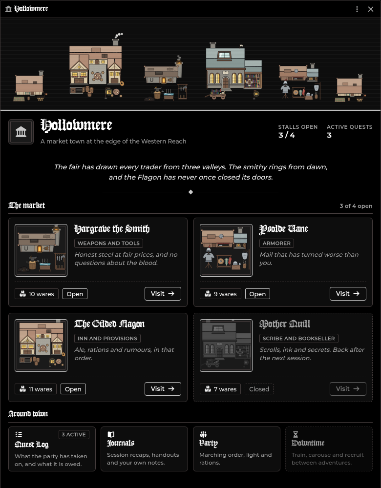

# Town Landing Page

[← Wiki home](index.md)

A front door for a town. When your players arrive in a scene you have set up,
a Town window opens: the town's name and welcome text, a stall for each
merchant, and tiles for the Quest Log, the Journals, the Party and Downtime.
Players shop with their own characters, and they can do it between sessions
with you not connected.

You set it up once per scene. Everything is read from the NPCs and the scene as
they are, so changing an NPC's items or a price changes the shop.

---

## Setting up a town

1. **Make each merchant an NPC actor.** Give it items of the types **Basic**,
   **Weapon** or **Armor**. Those items are the stock: an item's quantity is how
   many the merchant has, and its price is what it charges. Other item types
   are not sold.
2. **Right-click the scene** in the Scenes directory and choose **Landing
   page** (GM only).
3. **Fill in the town**, then pick an NPC under **Merchants** and press **Add
   merchant**. Set each merchant's fields (below).
4. **Save.** Players arriving in the scene get the Town window.

| Field | What it does |
|---|---|
| **Name, Tagline, Welcome text** | The heading and the italic line under the banner. Name defaults to the scene's name |
| **Banner picture** | An image you choose from your files. Empty shows a street of shops drawn from the module's own art |
| **Around town** | Which tiles players see: Quest Log, Journals, Party, Downtime |
| **Role, One-line pitch** | The tag and the quoted line on the merchant's stall |
| **Prices %** | 100 charges list price; 110 is 10% dearer, 80 is 20% cheaper (10 to 500) |
| **Buys back %** | What the merchant pays for what a player sells, as a share of the item's price (0 to 100) |
| **Open** | A closed merchant shows on its stall as closed and cannot be visited |
| **Restock** | Puts the merchant's whole shelf back when you press Save (see Restocking) |
| **Edit stock** | Opens the NPC, so you edit its items there |

An NPC can be a merchant once per town. The same NPC in two towns has its own
stock in each. Removing a merchant and adding the NPC again starts it fresh.

---

## What players see

- **Arriving** in a scene with a landing page opens the Town window by itself.
  Moving to a scene without one closes it. The GM is not opened on; the GM
  opens it from the Scenes directory (**Town window**).
- **Alt+T** opens it again on the scene being viewed. Change the key under
  *Configure Controls*.
- **The stalls** show each merchant's art, role, pitch and how many wares it
  has. **Visit** opens its shop.
- **The tiles** open the [Quest Log](Quest-Log.md), the Journal sidebar, the
  [Party](Party.md) and [Downtime](Downtime.md). A tile that cannot open is
  greyed and says why: Party until the player can see a party (the
  [Party](Party.md) needs at least Observer), Downtime until you start a
  downtime session.
- **The footer** says which character the player is, and their purse.

The GM also gets a pencil, which opens the editor, and a button that restocks
every shop.

---

## Shopping

- **Buying as** (bottom left) picks which of the player's characters pays. It
  starts as the selected token's character, else the one assigned to the
  account.
- **Filter and search.** The chips filter by Weapons, Armor and Gear; the
  search box narrows by name. Click a ware's name to read its description.
- **Buy.** Set the quantity with the stepper and press **Buy**. Coins come off
  the character's purse and the item lands on its sheet. A ware that costs more
  than the purse shows its price in red and cannot be bought. Gear sold in
  bundles (arrows, rations) is priced per bundle.
- **Sell.** The **Sell** tab lists what the character carries of those types
  and what one unit pays at the merchant's buy-back %. **Sell** sells one;
  **All** sells the stack. The merchant does not restock what it buys.
- **A chat card** is posted for each sale, in the merchant's name.
- **A downtime extortion swing** a character has armed applies to the next
  buy or sale, as in the [Merchant Shop](Merchant-Shop.md).

---

## Stock and restocking

A merchant's stock is its NPC's items. Each purchase is recorded on the
buyer's own character, and what is left on the shelf is the NPC's quantity
minus what everyone has bought. So the whole table draws on the same stock,
and every open shop updates as others buy.

- **Never runs out.** As the GM, press the infinity button beside a ware's
  type in the shopfront. A ware that never runs out shows **Plenty**.
- **Restock.** Press **Restock** on a merchant in the editor (it takes effect
  when you Save), or **Restock every shop** in the Town window. The shelf is
  back to the NPC's quantities. Nothing is written to any player's character.
- **Changing an NPC's quantity** changes the shelf at once: raise it to add
  stock without a restock.

---

## Without the GM

A player's purchase only changes their own character: coins out, the item in,
and a line in their own record. A player may write their own character, so
shopping works with no GM connected. This is why the stock is kept on the
buyers' characters and not in a setting only the GM can write.

Because of that, town sales are not written to the Merchant Shop's transaction
log or the [Session Recap](Session-Recap.md). The chat cards are the record.

---

## Limits

- A player shops as a Player character they own. The GM can shop as any.
- Two players taking the last unit at the same instant can both get it.
- Shopping as a token that is not linked to its actor is not counted against
  the stock.
- A merchant whose NPC was deleted is hidden from players and shown to you as
  an Unknown NPC, ready to remove.
- Items with no price sell for nothing.

---

## Related

[Merchant Shop](Merchant-Shop.md) (the GM-run shop for the whole table),
[Quest Log](Quest-Log.md), [Party](Party.md), [Downtime](Downtime.md).
